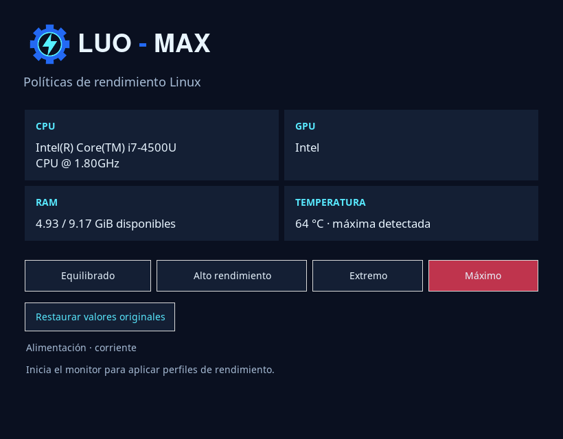
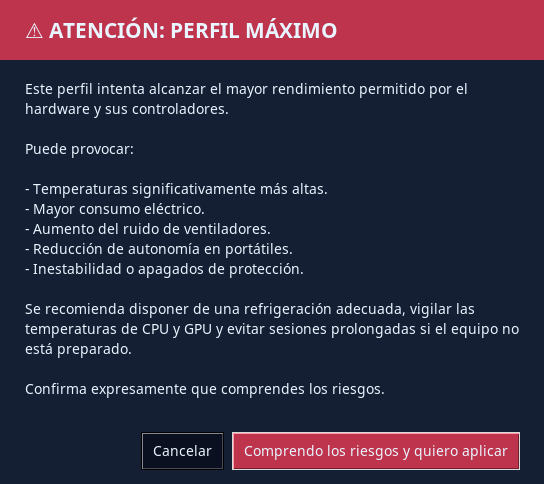

# LUO-MAX

<picture>
  <source media="(prefers-color-scheme: dark)" srcset="assets/logo-oscuro.svg">
  
</picture>

LUO-MAX (Linux Universal Optimizer) permite consultar el hardware y aplicar políticas de rendimiento Linux supervisadas y reversibles. Incluye una CLI y una interfaz gráfica opcional. Trabaja con los controles que exponen el kernel y los controladores, dentro de los límites configurados por el fabricante.



## Requisitos e instalación

- Linux con Python 3.9 o posterior en `/usr/bin/python3`, Bash y utilidades GNU.
- Para aplicar perfiles de rendimiento se necesita un administrador, controles compatibles y sensores térmicos válidos. La consulta funciona como usuario normal.
- GUI opcional con Tkinter (paquete `python3-tk` en Debian y Ubuntu) y sesión gráfica. Los cambios desde la GUI necesitan `pkexec` en `/usr/bin/pkexec` y un agente de Polkit. La GUI conserva los permisos del usuario.
- Si actualizas una versión anterior, sigue primero la [guía de migración](docs/MIGRACION.md).

```sh
sudo ./install.sh --systemd
sudo systemctl start luo-max.service
luo-max status
luo-max gui
```

El instalador deja el servicio disponible para iniciar manualmente. Durante el arranque del monitor se recupera cualquier sesión pendiente del mismo arranque de Linux. En sistemas sin systemd, instala con `sudo ./install.sh` y ejecuta `sudo luo-max daemon` en una terminal separada. Detén el monitor manual con Ctrl+C cuando termines. systemd añade un intento de restauración si el proceso del monitor cae.

## Perfiles

| Perfil | Comando | Política |
| --- | --- | --- |
| **Equilibrado** (predeterminado) | `sudo luo-max apply` | Delega la política al sistema. Si existe una sesión, recupera sus valores originales. |
| **Alto rendimiento** | `sudo luo-max apply alto` | Selecciona el governor `performance` donde esté disponible. Puede devolver una GPU AMD restringida al modo dinámico `auto`. |
| **Extremo** | `sudo luo-max apply extremo --confirm-risks` | Añade preferencia energética de rendimiento donde el controlador la exponga. Comprueba sensores y alimentación. |
| **Máximo** | `sudo luo-max apply maximo --confirm-risks` | Habilita el boost de fábrica cuando esté disponible y puede seleccionar el modo `high` de AMDGPU con sensores asociados. Requiere confirmación y comprueba sensores y alimentación. |

Consulta los ajustes candidatos con `luo-max apply maximo --dry-run`. La simulación consulta atributos y restricciones actuales. El conjunto real se calcula tras restaurar una sesión previa, si existe. Algunas máquinas exponen los mismos controles para más de un perfil. Intel y NVIDIA figuran en el inventario de GPU. Los ajustes de GPU se limitan a modos reversibles del controlador AMDGPU. En CPU se usan [CPUFreq](https://docs.kernel.org/admin-guide/pm/cpufreq.html), los [controles de Intel P-State](https://docs.kernel.org/admin-guide/pm/intel_pstate.html) y los atributos compatibles del controlador. Consulta los [controles térmicos y de energía de AMDGPU](https://docs.kernel.org/gpu/amdgpu/thermal.html).

### Protección térmica



El perfil Máximo puede aumentar la temperatura, el consumo y el ruido, reducir la autonomía y provocar inestabilidad o apagados de protección. Usa refrigeración adecuada y vigila la temperatura de CPU y GPU. LUO-MAX modifica políticas del controlador y opciones de boost de fábrica. No modifica voltajes, límites de potencia ni frecuencias del fabricante, ni realiza overclock físico. Tampoco borra temporales ni vacía cachés.

El monitor verifica cada dos segundos la telemetría de CPU y de las GPU que modifica. Restaura la sesión si desaparece una lectura, si alcanza el umbral preventivo de 80 °C o un umbral inferior calculado a partir del límite crítico del sensor, o si cambia la alimentación verificada de Extremo o Máximo. En portátiles, esos dos perfiles requieren corriente confirmada. Si un equipo no expone batería ni fuentes de alimentación en sysfs, el monitor lo trata como equipo sin batería. Tras una protección, el perfil requiere reactivación manual.

## Restauración y desinstalación

```sh
sudo luo-max restore
sudo systemctl stop luo-max.service   # si se inició el servicio
sudo ./uninstall.sh
```

La GUI ofrece **Restaurar valores originales**. El diario se guarda de forma atómica antes de escribir y registra objetivos y valores observados. La restauración comprueba los valores devueltos por los controladores. La desinstalación se detiene ante un error de restauración para conservar el ejecutable y el diario. Los bloqueos en `/var/lib/luo-max` se conservan para mantener la exclusión entre procesos. Para fallos parciales, diarios de otro arranque o instalaciones antiguas, consulta la [guía de migración y recuperación](docs/MIGRACION.md).

## Verificación

| Entorno | Resultado comprobado |
| --- | --- |
| Debian 13, Python 3.13.5, Intel i7-4500U y GPU Intel | Inventario real de solo lectura, GUI en Xvfb y diálogo de confirmación. |
| Debian 13, espacio de nombres Linux aislado con sysfs simulado | Instalación y desinstalación repetibles, verificación estática de la unidad systemd, CLI instalada, rechazo de Máximo sin confirmación, activación confirmada, restauración a 90 °C y restauración al detener el daemon. |
| Pruebas de regresión sin root | Perfiles, hardware simulado, sensores y alimentación, permisos, rollback, restauración parcial, daemon y scripts. |

```sh
python3 -m unittest discover -s tests -v
bash tests/integration-linux.sh   # requiere bubblewrap y espacios de nombres de usuario
```

GitHub Actions ejecuta las pruebas en Ubuntu 24.04 con Python 3.9 y 3.13. La validación local usó sysfs simulado para todas las escrituras. Siguen pendientes una sesión con systemd como gestor activo, la autenticación gráfica de Polkit y pruebas de escritura y restauración en hardware autorizado Intel, AMD, NVIDIA y ARM. La tabla refleja las rutas que se verificaron. El proyecto se entrega como candidato a revisión humana.

## Licencia y desarrollo con IA

Licencia [MIT](LICENSE). Los logotipos SVG y PNG del repositorio se diseñaron para LUO-MAX. La GUI utiliza Tkinter y Polkit instalados por la distribución. El repositorio no incluye copias de esas dependencias ni de las fuentes del sistema.

**LUO-MAX — Proyecto de código abierto desarrollado con asistencia de inteligencia artificial.**

Este proyecto ha sido creado y desarrollado con ayuda de herramientas de inteligencia artificial, incluyendo OpenAI Codex y ChatGPT.

La inteligencia artificial ha participado en tareas de arquitectura, programación, documentación, análisis y revisión del software.

El proyecto es mantenido y supervisado por sus colaboradores humanos.

El uso de IA no sustituye las pruebas, la revisión humana ni las garantías de seguridad.

**Licencia: MIT.**
